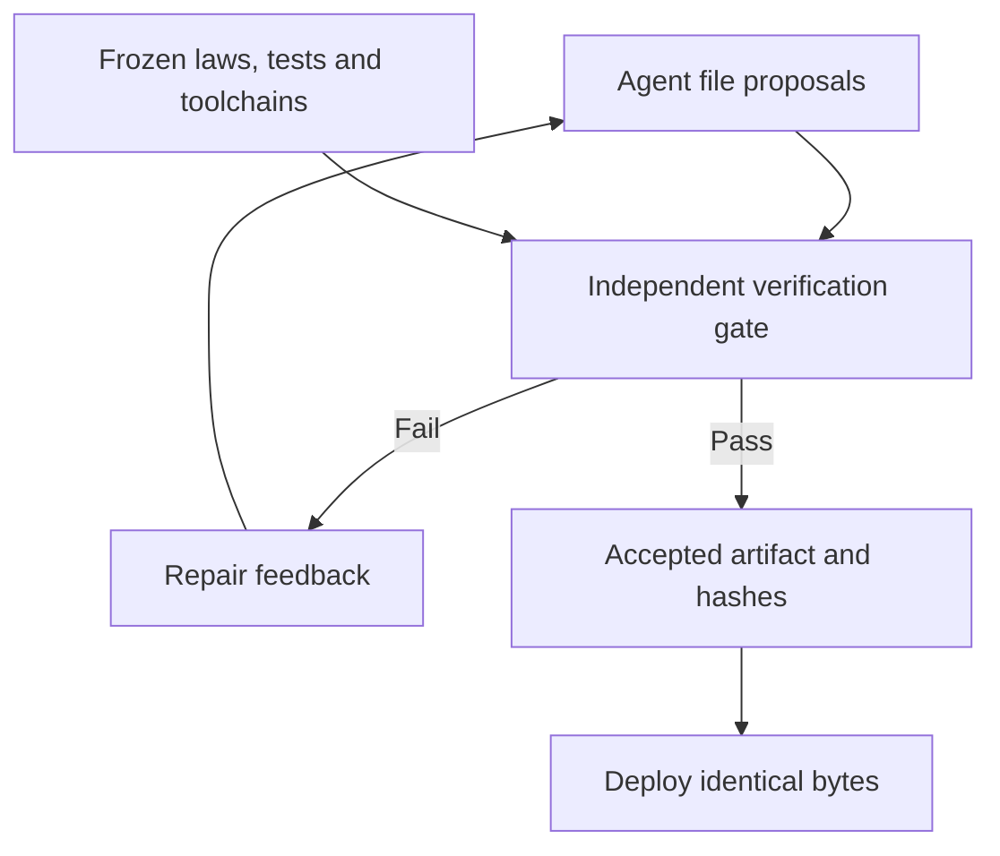

# ProofGate

**An independent verification gate for agent-generated code.**

ProofGate combines formal proofs with independent service tests, then deploys the exact build that passed. This research prototype demonstrates a TypeScript/SQLite credit-reservation service with admission logic compiled from Bend.

## Choose a path

- **Check your selected Python code:** [experimental JSON fixture adapter](docs/framework/EXTERNAL-JSON.md). Linux sandbox required; finite observations with no admission authority. [Entitlement walkthrough](docs/framework/TRY.md) provides a fixed demo.
- **Reproduce the research:** follow the reservation demonstration below. Offline recorded consistency and fresh formal/service execution are separate commands.
- **Understand assurance:** [framework trust boundary](docs/framework/SPEC.md#authority-and-trust) and [architecture](docs/architecture.md).
- **Browse retained evidence:** [validation decision](docs/framework/VALIDATION-DECISION.md) links the historical pairs, null results and coverage limits.

## The demonstration

In the [recorded Codex experiment](REPORT.md#actual-codex-implementation-and-repair), an injected double-charging bug passed the core proofs but failed integration tests. The agent repaired it, the unchanged gate accepted the repair, and a separate supervisor deployed the accepted artifact without rebuilding.



## What is checked

The admission function must satisfy four universal mathematical properties:

| Property | Required behavior |
| --- | --- |
| Exact grant | A successful grant equals the requested amount. |
| Conservation | The next balance plus the grant equals the prior balance. |
| Correct rejection | Nonpositive or unaffordable requests receive nothing and preserve the balance. |
| Correct acceptance | Every positive, affordable request succeeds. |

The gate also builds the executable, checks the compiled core against 11,716 cases, and tests HTTP validation, SQLite persistence, retries, conflicts, concurrency, and restart behavior.

Recorded negative controls show where different failures are caught:

| Deliberate defect | Result |
| --- | --- |
| Over-allocation or always rejecting | Formal check fails. |
| Charging again when a request is retried | Integration check fails. |
| Changed laws or a disabled check | Frozen-baseline validation fails. |
| Unavailable checker or controlled timeout | Gate rejects the run. |

See the [acceptance record](ACCEPTANCE.md) and [architecture](docs/architecture.md) for the evidence and boundaries.

## Try it locally

From the repository root, inspect the recorded evidence offline:

```sh
python3 -B scripts/check_release.py
```

Requires Python 3.10+ on a POSIX host; no downloads or pip dependencies. It checks the frozen baseline, recorded artifact hashes and outcomes, and portable checker regressions. To rerun the formal proofs and service tests:

```sh
python3 reproduce.py
```

Full reproduction requires **Linux x86_64**, Python 3.10+, bubblewrap with usable unprivileged namespaces, `tar`, `zstd`, and xz extraction support. Allow several GB for toolchains and artifacts, plus access to pinned release downloads.

The command runs valid and negative cases, copies an accepted artifact, and smoke-tests it on loopback. Results go under `runs/`. No Codex login, model API key, or npm installation is needed. The agent session is recorded evidence; reproduction makes no model calls.

[Follow the demo walkthrough](docs/demo.md) to inspect the results and try the reservation API.

## Experimental developer trial

A new portable evidence kernel and local entitlement adapter explore reusable verification for agent-written business logic. [Try a change and inspect a concrete counterexample](docs/framework/TRY.md). This experimental interface is separate from the frozen reservation demonstration below.

## Scope

The proofs cover pure admission logic. Compilation, numeric conversion, HTTP, storage, and deployment have tested or trusted boundaries. This local, single-process prototype does not establish distributed correctness or production security. Artifact hashes connect tested and deployed bytes; the evaluator and host remain trusted.

Further experiments cover [process crashes](CRASH_REPLAY.md), [overlapping histories](REALTIME_HISTORY.md), [lost responses](PENDING_HISTORY.md), and [incomplete HTTP bodies](PARTIAL_BODY.md).

## License

ProofGate's original code and documentation are licensed under the [MIT License](LICENSE). Third-party components retain their own licenses and notices, including the Bend-derived runtime code under Apache License 2.0; see [Third-party notices](THIRD_PARTY_NOTICES.md).

[Technical report](REPORT.md) · [Source](candidate/) · [Recorded evidence](evidence/) · [Architecture](docs/architecture.md) · [Contributing](CONTRIBUTING.md) · [Security](SECURITY.md)
